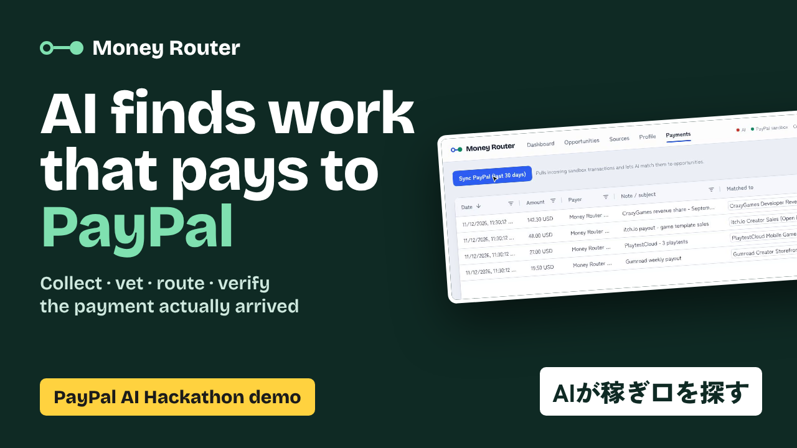
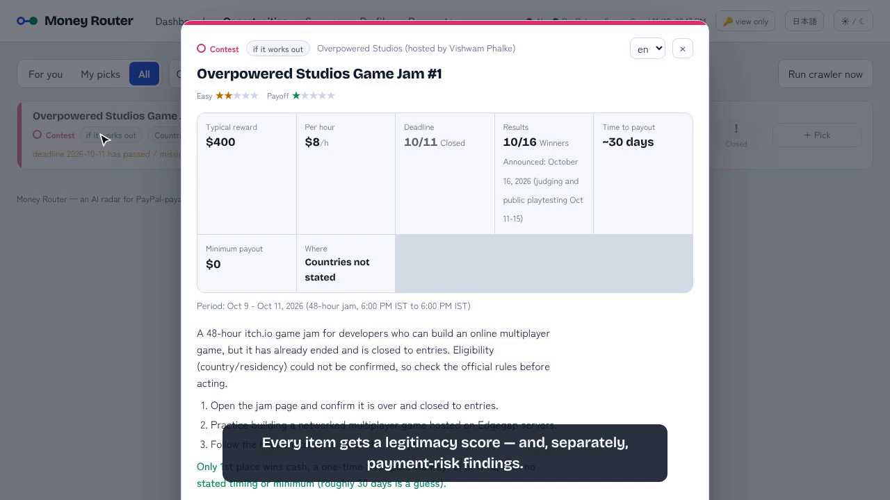
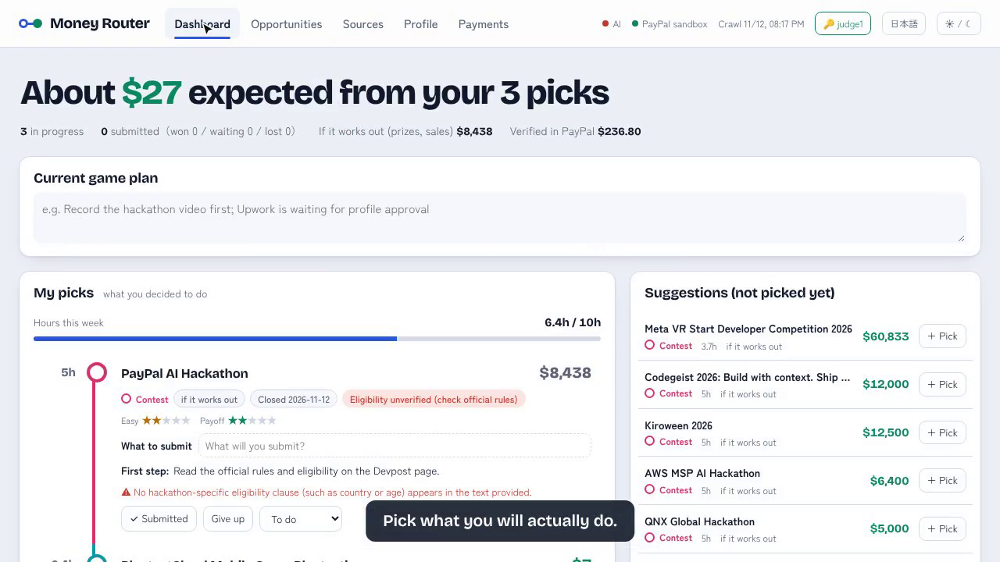

# Money Router — an AI radar for PayPal-payable work, worldwide

> English version: [README.md](README.md)

**世界中から稼ぎ口を集め、AIで審査し（正当性・参加資格・支払いリスク）、良いものをあなたに振り分け、結果を実際のPayPal入金で検証する。**

> [PayPal AI Hackathon](https://paypalaihackathon.devpost.com/)（Devpost、2026）応募作。

- **ライブデモ:** https://money-router.kitakuarcade.com （キーなしは閲覧のみ。審査員には Devpost のテスト手順で個人キーを渡す）
- **デモ動画（2:40）:** Devpost の応募ページを参照
- **状態:** v1.0 稼働中 — 62の収集元を Claude で巡回、PayPal サンドボックスの Transaction Search / Invoicing / Payouts が端から端までつながっている



## 解く問題

個人のクリエイター・開発者・フリーランスは、ゲームポータル、バウンティ、マーケットプレイス、テストパネルなど、たくさんの小さな経路から報酬を受け取っている。多くはPayPalで払われるが：

- 散らばっていて比べにくい（最低出金額、支払い周期、国の条件、必要スキル）
- 詐欺や「実際には払われない」案件だらけ
- どの経路が実際にいくら払ったかを誰も記録していないので、次の判断が勘になる

## Money Router がすること

| 柱 | 何が起きるか | AI | PayPal |
|---|---|---|---|
| **Discover（集める）** | 毎日クローラーが登録済みプラットフォームの公開支払いページを読み、条件を構造化し、**PayPalで受け取れるものだけ**を残す。各案件に根拠つきの**正当性スコア**を付ける。 | 構造化抽出（tool use の JSON schema）＋正当性審査、曜日ごとのモデル切り替え | — |
| **Route（振り分ける）** | 国・スキル・週の時間・既存アカウントから、対象外の理由を明示したランキングと、時間予算内の**「今週やること」**を作る。 | 自由記述からのプロフィール解釈、案件ごとの「なぜ向くか／最初の一歩」 | — |
| **Pick & do（選んでやる）** | **+ やる** を押すと自分の案件になる：締切カウントダウン、出すもの、週の時間予算、状態の流れ（未対応 → 対応中 → 提出済／作業完了 → 入賞 → 入金済、さらに「やめる」「やっぱりやる」、1クリックで元に戻す）。コンテストの賞金は常に「結果次第」で、見込み収入には入れない。 | 要約、支払いリスク所見、参加資格チェック | — |
| **Track（検証する）** | **Transaction Search API** で入金を取得し、AIが案件と照合し（支払元の名前はブランド名と違うことが多い）、**確認済みの収入**をランキングに戻す。**Invoicing API** で請求書を下書き・送信する。 | 入金 ↔ 案件の照合 | Transaction Search、Invoicing、Payouts（デモ用の入金作成） |

おすすめしたのに入金がなかった案件はランキングが下がる。ツールが自分の役立ち度を測る。

| 支払いリスク所見 | 自分の案件 |
|---|---|
|  |  |

## 構成

```
Browser SPA (React + AG Grid Community)
        │
        ▼
Hono API (Node/TypeScript)                       PayPal Sandbox
  /api/route, /api/plan, /api/profile     ◄────► Transaction Search v1
  /api/paypal/sync, /api/paypal/invoice   ◄────► Invoicing v2, Payouts v1
  /api/crawl (+ プロセス内の定期実行)
        │
        ▼
Crawler: fetch → sha256 差分 → 抽出 (Claude) → 審査 (Claude, AUDIT_SCHEDULE) → マージ
        │
        ▼
data/runtime/*.json  （tmp+rename で書き込み、ユーザー別ファイルは data/runtime/users/<user>/）
```

### モデルの割り当て（`.env`）

AIの各工程はモデルIDの文字列なので、新しいモデルへの差し替えは1行で済む。

```env
MODEL_EXTRACT=claude-sonnet-5-5      # ページ → 構造化JSON（ページが変わったときだけ）
MODEL_AUDIT=claude-sonnet-5-5        # 正当性スコア（ページが変わったときだけ）
MODEL_MATCH=claude-opus-5-5          # PayPal入金 ↔ 案件の照合
MODEL_EXPLAIN=claude-opus-5-5        # 週次プランの説明
# 曜日ごとの審査スケジュール: <dow>:<model>:<full|diff>。full はページの変更に関係なく
# active な案件をすべて再審査する（詐欺化・条件改悪のドリフトを検知）。
AUDIT_SCHEDULE=mon:claude-fable-5-1:full,thu:claude-opus-5-5:full
```

スコアには `scored_by` / `scored_at` / `mode` を記録する。UIでは diff モードとシードのスコアを暫定（`*`）として表示し、モデル間で平均はしない。

## 動かし方

必要なもの: Node 20 以上。

```bash
git clone https://github.com/tinycore-hisanori/money-router
cd money-router
npm install            # client/ も一緒に入る
cp .env.example .env   # 下のキーを設定（モックモードなら不要）
npm run dev            # API は :3000、Vite 開発サーバーは :5173（/api をプロキシ）
```

http://localhost:5173 を開く。キーを設定しなければ**モックデータ**（`data/opportunities.seed.json`）で動き、ルーティング・プラン・除外・状態管理はすべて使える。ヘッダーにどの機能が有効かが表示される。

### AI（Claude）を有効にする

`ANTHROPIC_API_KEY` と `CRAWLER_MODE=live` を設定して：

```bash
npm run crawl          # または Opportunities の「Run crawler now」
```

### PayPal を有効にする（サンドボックスのみ）

サンドボックスの Business アカウント2つが2つの役を担う：

| | 役 | アプリ | `.env` |
|---|---|---|---|
| **A** | Money Router のユーザー（受け取る側） | `Money Router` | `PAYPAL_CLIENT_ID`、`PAYPAL_CLIENT_SECRET`、`PAYPAL_RECEIVER_EMAIL` = A のメールアドレス |
| **B** | CrazyGames や itch.io… のふりをするデモ用の支払元 | `Money Router Seeder` | `PAYPAL_SEED_CLIENT_ID`、`PAYPAL_SEED_CLIENT_SECRET` |

1. https://developer.paypal.com → Apps & Credentials（Sandbox）→ アカウント A を所有者として、種類 Merchant でアプリ `Money Router` を作る（自動作成された Business アカウントでよい）。
2. Testing Tools → Sandbox Accounts → 2つ目の **Business** アカウント（US）を作り、それを所有者にアプリ `Money Router Seeder` を作る。
3. B から A へデモ入金を送ってから同期する：

```bash
npm run seed:payments   # Payouts API: 受取アカウントへ各プラットフォームを模した入金を送る
# 少し待ってから UI で Payments -> "Sync PayPal"
```

`PAYPAL_ENV` は `sandbox` に固定されていて、それ以外ではサーバーが起動しない。

### 本番ビルド

```bash
npm run build && npm start   # API とビルド済み SPA を1プロセスで配信
```

ライブデモは小さなVPS上の PM2 プロセス1つで、Nginx + Cloudflare の背後で動いている。クローラーは `CRAWL_DAYS` の曜日（空なら毎日）の `CRAWL_HOUR_UTC` にプロセス内で実行される。巡回・収集元探索・レーダーはバックグラウンドジョブで、UIがポーリングする。`render.yaml` は1サービス構成の別デプロイ手段として残している。`npm run release` でフッターと `/api/health` に出るビルド番号が上がる。

## リポジトリ構成

```
src/shared/types.ts          データモデル（Opportunity, Source, UserProfile, Payment, …）
src/server/                  Hono API、ルートエンジン、PayPal クライアント、AI 工程
src/crawler/                 取得 / 抽出 / 審査のパイプライン
client/                      React + AG Grid の SPA
data/source_registry.json    クローラーが読む62の収集元（無効化したものは理由つき）
data/opportunities.seed.json モックの案件一覧（scripts/make-seed.ts で生成）
scripts/seed-payments.ts     PayPal Payouts によるデモ入金
scripts/demo/                デモ動画の録画（Playwright スクリーンキャスト + PayPal 入金の再生）
docs/SPEC_v1.0.md            仕様書
docs/SUBMISSION.md           Devpost 提出文
docs/VIDEO_SCRIPT.md         デモ動画のナレーション
docs/SOURCES_from_prize_board.md  作者の賞金ハンター帳から集めた収集元候補
docs/*.ja.md, README.ja.md   日本語版（既定は英語）
```

## 使用ツール

- **PayPal Developer Platform** — Transaction Search API、Invoicing API v2、Payouts API（サンドボックス）
- **Claude API**（Anthropic）— 構造化抽出、正当性審査、入金照合、プランの説明
- **AG Grid Community** — 案件と入金の表
- **Brave Search API** — ページの予備探索、規約検索、苦情検索、多言語 Event Radar
- Nginx、Cloudflare、PM2 — ホスティング
- Hono、React、Vite、TypeScript

## AIの費用は誰が払うのか

運営者が払うので、費用のかかる操作には制限をかけている：

- **管理者キー**（`ADMIN_TOKEN`）：UIで一度入力する（ヘッダーの🔑）。収集元探索・巡回・要約は無制限、見つけた収集元の承認／却下ができる。
- **審査員キー**（`JUDGE_TOKENS`、カンマ区切り、審査員にだけ非公開で渡す）：**キーごとに別ユーザー**（judge1、judge2、…）で、プロフィール・選んだ案件・状態・メモはサーバーに別々に保存される。同じ `?key=` リンクをスマホで開いても同じ画面になる。審査員ごとに1日の上限（`JUDGE_DAILY_DISCOVERY=10`、`JUDGE_DAILY_BRIEFS=200`、`JUDGE_DAILY_CRAWLS=5`）があり、承認／却下もできるので、探索 → 承認 → 巡回の一連を試せる。
- **公開（キーなし）は閲覧のみ**：公開デモでは読み取り専用の**デモユーザー**を表示する（運営者のデータは見せない）。プロフィール変更、案件を選ぶ、メモ、巡回、Event Radar、PayPal同期にはキーが必要。訪問者も全体の閲覧、要約の生成（`DEMO_DAILY_BRIEFS=50`/日）、AIによる収集元探索（`DEMO_DAILY_DISCOVERY=3`/日、結果は承認待ち）はできる。最悪の費用はこれらの数値で上限が決まる。
- **1クリックで解除**：`?key=<JUDGE_TOKEN>` 付きでデモを開くと、キーがブラウザに保存されアドレスバーから消える。
- キーを1つも設定していないローカル環境はすべて開放。

製品にするなら「AIによる収集元探索」が自然な有料枠（例：月N回）で、閲覧とルーティングは無料のまま。

## 免責

収入の数字は公開ページから抽出した推定値で、間違っていたり古かったりすることがある。時間やお金をかける前に、必ず各プラットフォームの規約を確認すること。Money Router が銀行やカードの情報を求めたり保存したりすることはない。

## ライセンス

MIT — [LICENSE](LICENSE) を参照。
