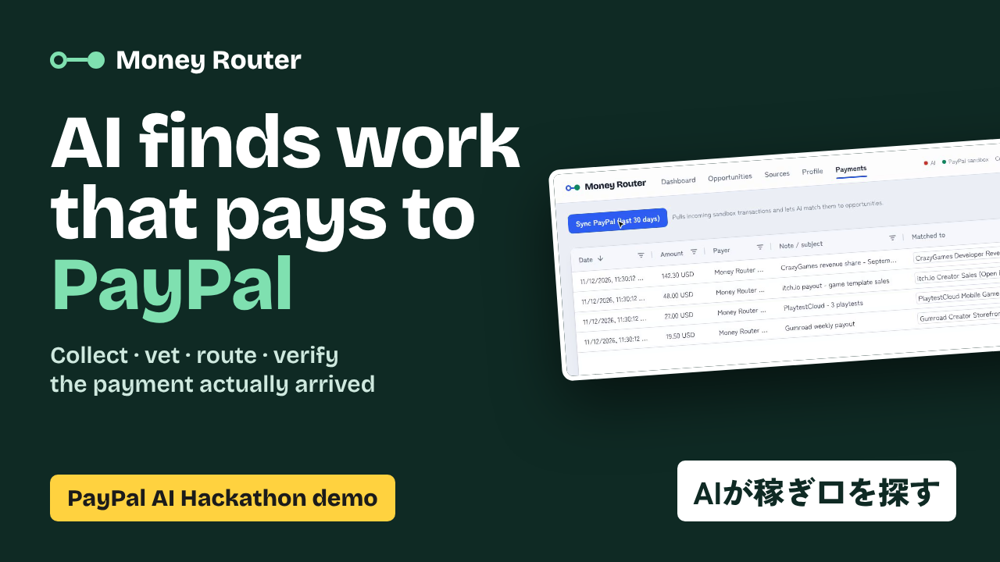
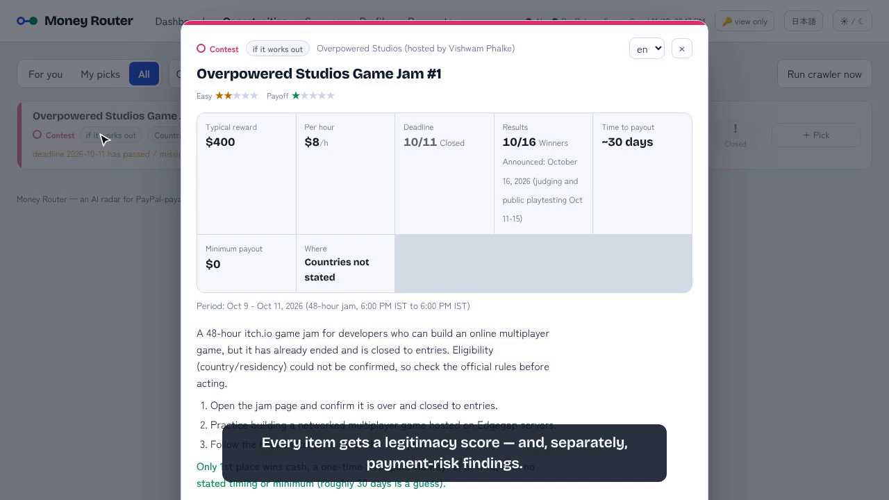
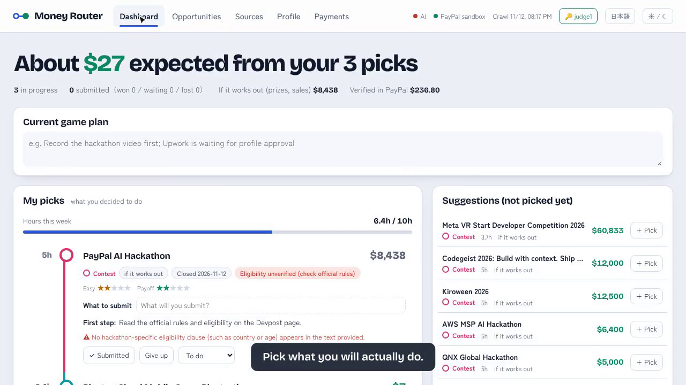

# Money Router — an AI radar for PayPal-payable work, worldwide

> 日本語版: [README.ja.md](README.ja.md)

**Collects money-making opportunities from all over the world, has AI vet them (legitimacy, eligibility, payment risk), routes the best ones to you, and verifies the result against your real PayPal transactions.**

> Entry for the [PayPal AI Hackathon](https://paypalaihackathon.devpost.com/) (Devpost, 2026).

- **Live demo:** https://money-router.kitakuarcade.com (view-only without a key; judges get personal keys in the Devpost testing instructions)
- **Demo video (2:40):** https://youtu.be/ojJBASD8UA4
- **Status:** v1.0, running live — 62 sources crawled with Claude, PayPal sandbox Transaction Search / Invoicing / Payouts wired end to end



## The problem

Independent creators, developers and freelancers get paid through dozens of small channels — game portals, bounty programs, marketplaces, testing panels. Many of them pay out via PayPal, but:

- they are scattered and hard to compare (payout minimums, cycles, country rules, required skills),
- the space is full of scams and "never actually pays" offers,
- nobody tracks which channel really paid how much, so the next decision is a guess.

## What Money Router does

| Pillar | What happens | AI | PayPal |
|---|---|---|---|
| **Discover** | A daily crawler reads each registered platform's public payout page, extracts structured terms, and keeps **only PayPal-payable** opportunities. Each one gets a calibrated **legitimacy score** with notes. | Structured extraction (tool-use JSON schema) + legitimacy audit, with per-weekday model rotation | — |
| **Route** | Your country, skills, weekly hours and existing accounts turn the catalog into a ranked list with explicit *why-not* reasons, and a greedy **"this week" plan** within your hours budget. | Profile parsing from free text; plain-English "why / first step" per item | — |
| **Pick & do** | Press **+ Pick** and it becomes yours: deadline countdown, what you'll submit, a weekly hours budget and a status flow (to do → in progress → submitted / work done → won → paid, plus give up / pick again, one-click undo). Contest prizes always count as "if it works out", never as expected income. | Brief, payment-risk findings, eligibility check | — |
| **Track** | Pull incoming payments with the **Transaction Search API**, let AI match them to opportunities (payer names rarely equal brand names), and feed **verified income** back into the ranking. Draft and send invoices via the **Invoicing API**. | Payment ↔ opportunity reconciliation | Transaction Search, Invoicing, Payouts (demo seeding) |

Opportunities that were recommended but never paid sink in the ranking. The tool measures its own usefulness.

| Payment-risk findings | My picks |
|---|---|
|  |  |

## Architecture

```
Browser SPA (React + AG Grid Community)
        │
        ▼
Hono API (Node/TypeScript)                       PayPal Sandbox
  /api/route, /api/plan, /api/profile     ◄────► Transaction Search v1
  /api/paypal/sync, /api/paypal/invoice   ◄────► Invoicing v2, Payouts v1
  /api/crawl (+ in-process daily scheduler)
        │
        ▼
Crawler: fetch → sha256 diff → extract (Claude) → audit (Claude, AUDIT_SCHEDULE) → merge
        │
        ▼
data/runtime/*.json  (tmp+rename writes; per-user files under data/runtime/users/<user>/)
```

### Model routing (`.env`)

Every AI step is a model ID string, so swapping in a newer model is a one-line change.

```env
MODEL_EXTRACT=claude-sonnet-5-5      # page -> structured JSON (only when a page changed)
MODEL_AUDIT=claude-sonnet-5-5        # legitimacy score (only when a page changed)
MODEL_MATCH=claude-opus-5-5          # PayPal payment <-> opportunity matching
MODEL_EXPLAIN=claude-opus-5-5        # weekly plan explanations
# Weekday audit schedule: <dow>:<model>:<full|diff>. "full" re-audits every active
# opportunity regardless of page changes (catches drift toward scam / worse terms).
AUDIT_SCHEDULE=mon:claude-fable-5-1:full,thu:claude-opus-5-5:full
```

Scores record `scored_by` / `scored_at` / `mode`; the UI marks diff-mode and seed scores as provisional (`*`) rather than averaging across models.

## Run it

Requirements: Node 20+.

```bash
git clone https://github.com/tinycore-hisanori/money-router
cd money-router
npm install            # also installs client/
cp .env.example .env   # fill in keys below (optional for mock mode)
npm run dev            # API on :3000, Vite dev server on :5173 (proxies /api)
```

Open http://localhost:5173. With no keys set, the app runs on **mock data** (`data/opportunities.seed.json`); routing, plans, exclusions and execution tracking all work. The header shows which capabilities are live.

### Enable AI (Claude)

Set `ANTHROPIC_API_KEY` and `CRAWLER_MODE=live`, then:

```bash
npm run crawl          # or click "Run crawler now" in Opportunities
```

### Enable PayPal (sandbox only)

Two sandbox Business accounts play two roles:

| | Role | App | `.env` |
|---|---|---|---|
| **A** | The Money Router user (receives money) | `Money Router` | `PAYPAL_CLIENT_ID`, `PAYPAL_CLIENT_SECRET`, `PAYPAL_RECEIVER_EMAIL` = A's email |
| **B** | Demo payer pretending to be CrazyGames, itch.io… | `Money Router Seeder` | `PAYPAL_SEED_CLIENT_ID`, `PAYPAL_SEED_CLIENT_SECRET` |

1. https://developer.paypal.com → Apps & Credentials (Sandbox) → Create App `Money Router`, type Merchant, owned by account A (the auto-created Business account is fine).
2. Testing Tools → Sandbox Accounts → Create a second **Business** account (US). Create App `Money Router Seeder` owned by it.
3. Seed demo payouts from B to A, then sync:

```bash
npm run seed:payments   # Payouts API: simulated platform payments into the receiver account
# wait a minute, then in the UI: Payments -> "Sync PayPal"
```

`PAYPAL_ENV` is hard-locked to `sandbox`; the server refuses to start otherwise.

### Production build

```bash
npm run build && npm start   # serves API + built SPA from one process
```

The live demo runs as one PM2 process on a small VPS behind Nginx + Cloudflare. The crawler runs in-process at `CRAWL_HOUR_UTC` on the weekdays in `CRAWL_DAYS` (empty = daily); crawl, discovery and radar runs are background jobs the UI polls. `render.yaml` is kept as an alternative single-service deploy. `npm run release` bumps the build number shown in the footer and `/api/health`.

## Repository layout

```
src/shared/types.ts          data model (Opportunity, Source, UserProfile, Payment, …)
src/server/                  Hono API, route engine, PayPal client, AI steps
src/crawler/                 fetch / extract / audit pipeline
client/                      React + AG Grid SPA
data/source_registry.json    the 62 sources the crawler reads (disabled ones keep a reason)
data/opportunities.seed.json mock catalog (generated by scripts/make-seed.ts)
scripts/seed-payments.ts     PayPal Payouts demo seeding
scripts/demo/                demo-video recorder (Playwright screencast + PayPal fixture replay)
docs/SPEC_v1.0.md            full specification
docs/SUBMISSION.md           Devpost submission text
docs/VIDEO_SCRIPT.md         demo video narration
docs/SOURCES_from_prize_board.md  candidate sources from the author's prize-hunter board
docs/*.ja.md, README.ja.md   Japanese versions (English is the default)
```

## Tools used

- **PayPal Developer Platform** — Transaction Search API, Invoicing API v2, Payouts API (sandbox)
- **Claude API** (Anthropic) — structured extraction, legitimacy audits, payment matching, plan explanations
- **AG Grid Community** — opportunity and payment grids
- **Brave Search API** — fallback page discovery, rules lookup, complaint search, multilingual Event Radar
- Nginx, Cloudflare, PM2 — hosting
- Hono, React, Vite, TypeScript

## Who pays for the AI?

The operator does, so costly actions are guarded:

- **Admin key** (`ADMIN_TOKEN`): entered once in the UI (🔑 in the header) — unlimited Discovery, crawls and briefs; may approve/reject discovered sources.
- **Judge keys** (`JUDGE_TOKENS`, comma-separated, shared privately with hackathon judges): **each key is its own user** (judge1, judge2, …) with a separate profile, picks, statuses and notes stored on the server — open the same `?key=` link on a phone and the board is the same. Each judge has its own daily pool (`JUDGE_DAILY_DISCOVERY=10`, `JUDGE_DAILY_BRIEFS=200`, `JUDGE_DAILY_CRAWLS=5`) and may approve/reject, so the full discover → approve → crawl loop can be exercised.
- **Public (no key) is view-only** on a hosted demo and shows a read-only **demo user** (never the operator's data); so changing the profile, picking opportunities, notes, crawling, Event Radar and PayPal sync need a key. Visitors can still browse everything, generate briefs (`DEMO_DAILY_BRIEFS=50`/day) and run AI Discovery (`DEMO_DAILY_DISCOVERY=3`/day; results wait for approval). Worst-case cost is bounded by these numbers.
- **One-click unlock**: open the demo with `?key=<JUDGE_TOKEN>` — the key is stored in the browser and removed from the address bar.
- A local install with no keys configured is fully open.

In a product, "AI Discovery" is the natural paid tier (e.g. N runs per month); browsing and routing stay free.

## Disclaimer

Earnings figures are estimates extracted from public pages and may be wrong or out of date. Always check the platform's own terms before committing time or money. Money Router never asks for or stores bank or card details.

## License

MIT — see [LICENSE](LICENSE).
